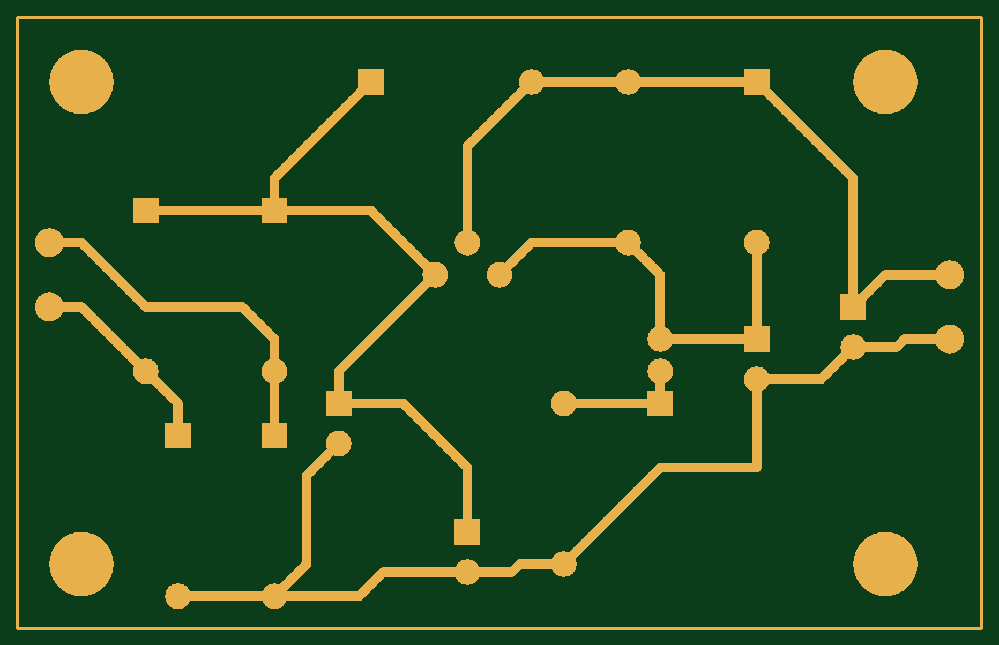

# Variable DC Bench Power Supply (LM317) — PCB Design & Build

An AC-to-DC **variable bench power supply** that was designed, laid out, built into an enclosure and safety-tested. Mains (115 VAC, 60 Hz) goes through a fused transformer, a rectifier and filter, and an **LM317** adjustable linear regulator. The output is adjustable from about **2 V to 14 V** on front-panel binding posts.

Team project of two for **ECP455 – Electronic Circuit Prototyping**, Computer Engineering Technology, Seneca Polytechnic (Winter 2024).

**Skills shown:** linear power-supply design · schematic capture and PCB layout (PADS) · Gerber/drill output for fabrication · component selection and BOM costing (Digi-Key) · enclosure build and mains wiring · electrical safety testing



---

## Design

```
115 VAC ─ fuse (1 A) ─ transformer ─ rectifier ─ bulk filter ─ LM317 ─ output filter ─ binding posts
                                       (1N4001)    (1000 µF)     │
                                                                        └─ R1 + 10 kΩ pot sets VOUT
```

- **Regulator:** LM317T (TO-220, 1.5 A). V<sub>OUT</sub> = 1.25 V × (1 + R<sub>2</sub>/R<sub>1</sub>), with R<sub>2</sub> being the 10 kΩ front-panel potentiometer.
- **Rectification and filtering:** 1N4001 diodes, a 1000 µF / 50 V bulk capacitor, and 1 µF / 10 µF / 470 µF capacitors around the regulator for stability and transient response.
- **Protection:** a 1 A 5×20 mm glass fuse in a panel-mount holder on the line side, protective-earth bonding to the die-cast enclosure, and a strain-relief cable gland on the line cord.
- **Mechanical:** BUD die-cast aluminium enclosure, PCB on 6-32 standoffs, quick-disconnect terminals for the transformer and panel wiring, and red and black binding posts.

## Requirements and tests

The project was marked against the school's mains-safety standard (SPE-1000-13). The supply had to pass all of these before it could be powered on outside the test bench:

| Test | What it checks |
|---|---|
| Ground continuity | enclosure is bonded to protective earth |
| **Hi-Pot** (dielectric withstand) | no breakdown between live parts and chassis at high voltage |
| **Insulation resistance** | leakage between mains and chassis is within limit |
| Drop test | build survives handling without loose parts or exposed conductors |
| Output range | min ≤ 2 V and max ≥ 14 V at the binding posts |

## Files

```
hardware/pads/power-supply.sch   PADS Logic schematic
hardware/pads/power-supply.pcb   PADS Layout board
hardware/pads/power-supply.eco   engineering change order (schematic → layout sync)
hardware/gerber/                 Gerber RS-274X (bottom copper, outline) + Excellon drill, as sent to fabrication
hardware/bom.csv                 bill of materials with Digi-Key part numbers and links (also bom.xlsx)
```

The board is **single-sided** (bottom copper only). You can view the Gerbers in any viewer, for example [gerbv](https://gerbv.github.io/), KiCad's GerbView, or an online viewer.

**BOM total:** $138.52 CAD before tax, including enclosure, panel hardware and connectors (the transformer isn't on the BOM).

## What I learned

- Mains-powered builds are mostly about safety: fusing, earthing, creepage, strain relief, and passing Hi-Pot and IR tests come before "does it output the right voltage".
- Laying out a single-sided board means thinking about jumpers and trace routing early, and making the high-current paths short and wide.
- Building a real BOM taught me about footprint matching, voltage ratings (every capacitor is rated above the peak rectified voltage) and hardware that's easy to miss, like nuts, standoffs and QD terminals.
